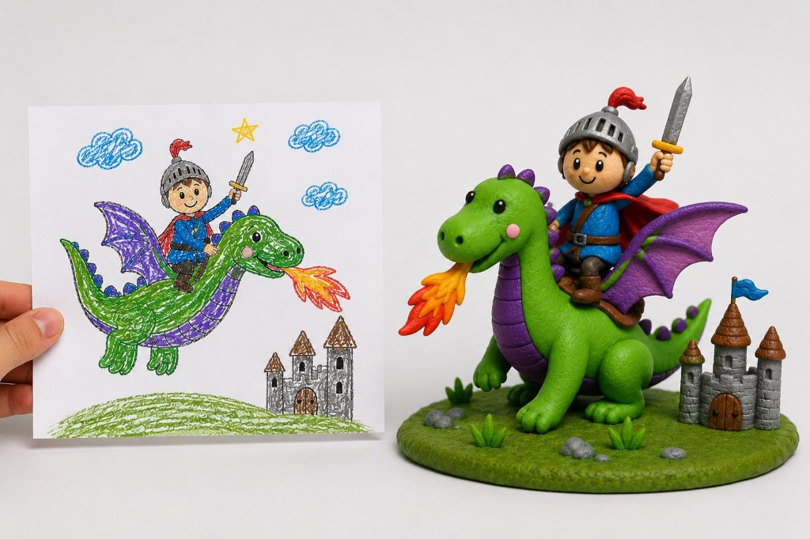

# Dream3D 🎨✨

**Dream3D** transforms children's drawings, paintings, and wild imaginations into tangible, vibrant 3D physical figurines and sculptures.

## 🚀 Live Demo & Deployment
- Configured out-of-the-box for **Vercel** (`vercel.json` included).
- Contact and order inquiry powered by **Formspree**: `https://formspree.io/f/mnpdqlpl`.

## 📦 Features
- **Magical Hero Section** showcasing 2D drawing to 3D sculpture transformation.
- **Childhood Keepsake Highlights**: non-toxic materials, durable resin, faithful character reproduction.
- **3-Step Process Guide**: Snap & Upload -> 3D Sculpting -> Doorstep Keepsake Delivery.
- **Formspree Inquiry Form** directly on the landing page for quick parent requests and uploads.
- **Responsive & Modern Design** built with clean HTML5 & CSS3.

## 🛠️ Deploy to Vercel
Simply import this repository on [Vercel](https://vercel.com/new) and click **Deploy**!
